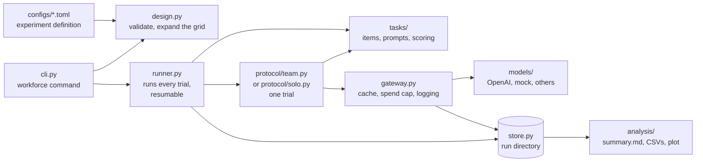

# workforce: LLM agent teams under a fixed token budget

Research harness for the study in [`multi-agent-experimental-design.md`](multi-agent-experimental-design.md):
do teams of LLM agents beat single agents, and does the effect come from **team size**,
**procedural (cognitive) diversity** or **communication**, when the whole team shares a
**fixed total token budget** per problem?

The harness runs declarative factorial experiments on MuSiQue, MuSR and HumanEval (plus AIME and
LiveCodeBench as harder candidates), logs every model call, resumes interrupted runs without
paying twice, and regenerates all results tables from the logs. A solo-iteration mode measures
how one agent's accuracy grows with the tokens it spends alone.

**Results so far**

- **[Solo-scaling calibration: plain-language results](docs/solo-calibration-results.md).**
  When one agent keeps checking its own work, AIME and LiveCodeBench (hard problems) gain about
  +0.17 to +0.19 accuracy and then level off (AIME at about 16k tokens, LiveCodeBench at about
  32k). MuSiQue gets slightly worse as the agent talks itself into "not stated" answers, MuSR
  shows no reliable gain, and HumanEval is at the ceiling. Keep AIME and LiveCodeBench for the
  collaboration-onset study. Full tables: [Solo-scaling calibration](#solo-scaling-calibration).
- **[Pilot](#pilot)** of the first experiment (teams of 1, 3 and 5 agents, 20 items per
  benchmark): validates the pipeline and sizes the full experiment
  ([cost estimate](#cost-estimate-for-the-full-first-experiment)). Its CIs are too wide for
  findings.

- [How the code fits together](#how-the-code-fits-together)
- [Setup](#setup)
- [Running experiments](#running-experiments)
- [Defining an experiment](#defining-an-experiment)
- [How the protocol and budget work](#how-the-protocol-and-budget-work)
- [Design decisions where the doc was ambiguous](#design-decisions-where-the-doc-was-ambiguous)
- [Measurements](#measurements)
- [Adding a provider or a benchmark](#adding-a-provider-or-a-benchmark)
- [Pilot](#pilot)
- [Cost estimate for the full first experiment](#cost-estimate-for-the-full-first-experiment)
- [Solo-scaling calibration](#solo-scaling-calibration)
- [Data and licenses](#data-and-licenses)
- [Known limitations](#known-limitations)

## How the code fits together



**Life of a run.** `workforce run config.toml` loads the config (`design.py`) and the API key
(`env.py`), creates a run directory (`store.py`) and hands it to `runner.py`. The runner loads
each benchmark's items once (`tasks/`, downloaded and checksummed by `tasks/download.py`), saves
them in the run, and builds one trial per benchmark x condition x item x replication. Each trial
runs a protocol: `protocol/team.py` for teams (initial answers, anonymous reveal, critique
rounds, vote) or `protocol/solo.py` for one agent checking its own work. Protocols build prompts
(`protocol/prompts.py`), keep the token budget (`protocol/budget.py`) and send every model call
through `gateway.py`. The gateway answers from the run's call log when the same call was already
made, otherwise enforces the spend cap, calls the provider (`models/`) and appends the call to
the log. The task parses and scores each answer, and the runner appends one record per finished
trial. `analysis/` turns the trial records into `summary.md` and CSVs; nothing in the analysis
needs the network. Because every call is logged and keyed by its exact request, `resume` and
`summarize --rebuild` replay a run without paying for any call twice.

**Files.**

| Path | What it does |
|---|---|
| `README.md` | This file: design, usage, results. |
| `multi-agent-experimental-design.md` | The study design the harness implements. |
| `docs/solo-calibration-results.md`, `docs/solo-calibration.png` | Solo-scaling calibration write-up and figure. |
| `configs/*.toml` | Experiment definitions: `pilot`, `first-experiment`, `full-factorial`, `mixed-models.example`, `solo-calibration` (+ `-64k` extension), `smoke-mock` (offline). |
| `pyproject.toml`, `uv.lock`, `.python-version` | Package definition (the `workforce` command), pinned dependencies, Python version. |
| `LICENSE` | MIT License for the code (datasets keep their own licenses). |
| `AGENTS.md` (`CLAUDE.md` links to it) | Short notes for coding agents working on this repository. |
| `.gitignore` | Keeps `runs/`, `data/` and `.env` out of git. |
| **`src/workforce/`** | |
| `cli.py` | The `workforce` command: `run`, `resume`, `summarize`, `estimate-cost`, `grid`, `fetch-data`, `plot-solo`. |
| `design.py` | Parses and validates a config; expands the factorial grid into conditions; assigns procedures and models to agents. |
| `env.py` | Loads API keys from an env file without printing them. |
| `runner.py` | Builds the trial list, skips finished trials, runs the rest concurrently under the spend cap; offline rebuild. |
| `gateway.py` | The only path to a model: call cache, spend guard, per-model concurrency, call log. |
| `store.py` | The run directory: manifest, items, append-only call, trial, error and event logs. |
| `cost.py` | Hard cost bound from a config, and cost projection from a finished run. |
| `protocol/team.py` | One team trial: simultaneous initial answers, anonymized reveal, critique rounds, vote. |
| `protocol/solo.py` | One agent's solo trajectory: self-check steps, token checkpoints, resumable state. |
| `protocol/budget.py` | Per-problem token budget: per-phase allowances and reservations. |
| `protocol/prompts.py` | Every prompt the agents see. |
| `protocol/procedures.py` | Problem-solving procedures (the diversity manipulation) and diversity levels. |
| `protocol/parsing.py` | Reads `<answer>`, `<confidence>`, `<evidence>`, `<critique>` from responses. |
| `protocol/voting.py` | Anonymous majority vote with a confidence tie-break. |
| `protocol/mock_agent.py` | Fake agent behind the mock provider, for offline runs and tests. |
| `models/base.py` | Provider interface and request, response and usage types; retries and backoff. |
| `models/openai_compat.py`, `models/openai.py` | Adapter for any OpenAI-compatible server, and the OpenAI API. |
| `models/mock.py` | Deterministic offline provider. |
| `models/registry.py`, `models/pricing.py`, `models/tokens.py` | Provider lookup by name, price table, pre-call token counting. |
| `tasks/base.py`, `tasks/registry.py` | Benchmark interface (load, prompt, parse, score, answer equivalence) and lookup by name. |
| `tasks/musique.py`, `musr.py`, `humaneval.py`, `aime.py`, `livecodebench.py` | The benchmarks. |
| `tasks/toy.py` | Synthetic arithmetic task for offline runs and tests. |
| `tasks/download.py` | Pinned, checksummed dataset downloads into the data directory. |
| `tasks/sandbox.py` | Runs generated code in a resource-limited subprocess (HumanEval, LiveCodeBench). |
| `tasks/text_metrics.py` | Answer normalization, exact match and F1. |
| `analysis/metrics.py`, `analysis/solo.py` | Outcome, gain, team-process and solo-checkpoint metrics from trial records. |
| `analysis/report.py` | Writes `summary.md`, `conditions.csv`, `solo_checkpoints.csv`. |
| `analysis/stats.py`, `analysis/similarity.py` | Bootstrap CIs and other statistics; TF-IDF text similarity. |
| `analysis/plot.py` | Accuracy-vs-tokens figure for solo runs. |
| **`tests/`** | Offline test suite: mock provider and the toy task, no downloads or keys. `conftest.py` and `helpers.py` hold shared fixtures. |

## Setup

Requires Python 3.11+ and [uv](https://docs.astral.sh/uv/).

```sh
uv sync                     # creates .venv with the two runtime deps (httpx, tiktoken)
uv run pytest               # fully offline, ~10 s
uv run ruff check
```

`plot-solo` draws charts with matplotlib, an optional extra (`uv sync --extra plot`; the dev
environment already has it).

API keys are read from the environment or from an env file, never from configs. The OpenAI
adapter accepts `OPENAI_API_KEY` or `OpenAI_API_Key`. The env file is chosen by `--env-file`,
then `$WORKFORCE_ENV_FILE`, then `./.env` (gitignored). Variables already set in the
environment win, and values are never printed or logged.

Benchmarks download on first use from pinned revisions with SHA-256 checks, into
`$WORKFORCE_DATA_DIR` (default `~/.cache/workforce/datasets`). Nothing is committed.

```sh
uv run workforce fetch-data musique musr humaneval aime livecodebench
```

AIME comes from MathArena's AIME 2025 and 2026 sets, fetched as JSON rows from the Hugging Face
dataset viewer and pinned by checksum. LiveCodeBench is release v6 (`test6.jsonl`, 134 MB).

## Running experiments

**Quick start**, from a fresh clone:

```sh
uv sync                                          # 1. install
uv run pytest                                    # 2. offline checks (no key, no downloads)
uv run workforce run configs/smoke-mock.toml     # 3. whole pipeline offline, fake model
echo 'OPENAI_API_KEY=sk-...' > .env              # 4. key for live runs (.env is gitignored)
uv run workforce run configs/solo-calibration.toml --items 2 --max-spend 0.5   # 5. tiny live run
cat runs/solo-calibration-*/summary.md           # 6. results tables
```

Step 5 downloads the benchmarks on first use (about 170 MB, mostly LiveCodeBench) and costs a
few cents; drop `--items` and `--max-spend` for the full run (about $2). Every command:

```sh
uv run workforce grid configs/pilot.toml                    # print the expanded grid
uv run workforce run configs/smoke-mock.toml                # offline mock run (toy task)
uv run workforce run configs/pilot.toml --mock              # real datasets, mock model
uv run workforce run configs/pilot.toml --env-file ~/keys/.env
uv run workforce resume runs/pilot-20261004-120000          # continue after interruption
uv run workforce summarize runs/pilot-20261004-120000       # rewrite summary.md / conditions.csv
uv run workforce summarize runs/... --rebuild               # re-derive trials from the call log, offline
uv run workforce estimate-cost --config configs/first-experiment.toml --from-run runs/pilot-...
uv run workforce plot-solo runs/solo-calibration-... --out solo-curves.png  # accuracy vs tokens
```

`run` options: `--mock` (swap every model for the offline mock), `--items N` (override items
per benchmark), `--max-spend USD`, `--run-dir`, `--env-file`. A run stops cleanly, and can be
resumed, when the spend cap would be exceeded, the account is out of quota, or more than 25
trials fail.

Each run lives in a gitignored `runs/<name>-<timestamp>/` directory:

| File | Contents |
|---|---|
| `manifest.json` | resolved config and its hash, git commit, versions, grid |
| `config.toml` | the config file as written |
| `items/<benchmark>.jsonl` | the exact items used, so a run never depends on a dataset changing |
| `calls.jsonl` | every model call: messages, params, seed, response, usage, latency, cost (append-only) |
| `trials.jsonl` | one record per (benchmark, condition, item, replication): all turns, votes, scores, budget ledger |
| `errors.jsonl`, `events.jsonl` | failed calls and run lifecycle |
| `summary.md`, `conditions.csv` | derived tables, regenerated by `summarize` |
| `solo_checkpoints.csv` | per-checkpoint solo results (solo runs only) |

**Resume without re-paying.** Each call has a key: a hash of the model identity, the full
request (messages, seed, temperature, max tokens) and its place in the experiment. A resumed
run replays the protocol, and any call already in `calls.jsonl` is served from the log. Because
the protocol is deterministic given the call outputs (seeded shuffles and tie-breaks),
`summarize --rebuild` can re-derive every trial offline after a scorer or analysis fix.

## Defining an experiment

Experiments are TOML files (stdlib `tomllib`, no extra dependency). Factors are lists and
expand into the full factorial grid. Unknown keys are rejected, so typos fail loudly.

```toml
[experiment]
name = "pilot"
seed = 20261004              # all seeds (calls, reveal order, tie-breaks) derive from this
replications = 1

[benchmarks.musique]         # musique | musr | humaneval | aime | livecodebench | toy_arithmetic
items = 20                   # omit for the whole benchmark
budget_tokens = 100000       # total team tokens per problem (see below)

[factors]
team_size = [1, 3, 5]
diversity = ["identical", "moderate"]            # also "strong", or your own levels
communication = ["independent", "horizontal-2r"] # "horizontal" = 1 round, "horizontal-<k>r",
                                                 # "solo" = solo iteration (N = 1 only)
model_assignment = ["homogeneous"]

[generation]                 # held constant across all conditions
temperature = 0.7
max_output_tokens_per_call = 8192
min_output_tokens = 200      # a call that cannot get this many output tokens is skipped

[budget]
count = "total"              # "total" (input + output) or "output"
disclose_allowance = true    # tell agents their per-response token allowance

[models.base]
provider = "openai"          # openai | openai_compatible | mock | "pkg.module:Class"
model = "gpt-6-luna"
params = { reasoning_effort = "none" }   # extra request fields, part of the cache key
# base_url, api_key_env, price = {input, output, cached_input}, supports_temperature,
# supports_seed, max_output_tokens, timeout_s, max_retries, concurrency

[model_assignments.homogeneous]
models = ["base"]            # agents cycle through this list

[run]
trial_concurrency = 12
max_spend_usd = 14.0
include_degenerate = false

[solo]                       # only used by communication = "solo"
checkpoints = [1000, 2000, 4000, 8000, 16000, 32000]  # <= each benchmark's budget_tokens
max_steps = 64
```

Diversity levels and procedures are data too. Defaults live in
[`protocol/procedures.py`](src/workforce/protocol/procedures.py) and can be overridden or extended:

```toml
[procedures.analogy]
instructions = "Recall a solved problem with the same structure and adapt its solution."

[diversity.custom]
procedures = ["decomposition", "analogy"]
by_team_size = { 5 = ["decomposition", "analogy", "falsification", "evidence_first", "analogy"] }
counterbalance = true
```

Example configs: [`pilot.toml`](configs/pilot.toml) (the pilot),
[`first-experiment.toml`](configs/first-experiment.toml) (the doc's first experiment at full
scale), [`full-factorial.toml`](configs/full-factorial.toml) (the doc's 3 x 3 x 2 grid with strong
diversity), [`mixed-models.example.toml`](configs/mixed-models.example.toml) (model assignment
as a factor, including a local OpenAI-compatible endpoint),
[`solo-calibration.toml`](configs/solo-calibration.toml) (solo accuracy vs tokens on five
benchmarks), and [`smoke-mock.toml`](configs/smoke-mock.toml) (offline).

## How the protocol and budget work

**Horizontal protocol** ([`protocol/team.py`](src/workforce/protocol/team.py)), exactly as in the doc:

1. Every agent independently writes an initial solution and states a 0-100 confidence.
2. All initial solutions are revealed simultaneously. A phase's calls all finish before any
   agent sees anything from that phase, so nobody anchors on a first speaker. Teammates appear
   as "Teammate solution k" in an order shuffled separately for each viewer, with stated
   confidences removed. Procedures, models and identities are never shown.
3. Each agent submits one critique and revision per round: one round in the core protocol
   (`horizontal`), two in the first experiment (`horizontal-2r`).
4. The team answer is an anonymous majority vote over the agents' final answers.
5. Ties go to the answer whose voters had the highest summed confidence, as stated before
   discussion. A remaining tie is a seeded random draw.

`independent` stops after step 1 and votes. That is the independent-ensemble control.

**Fixed total token budget** ([`protocol/budget.py`](src/workforce/protocol/budget.py)). Each
problem gets `budget_tokens`, shared by the whole team, counting input and output tokens of
every call. At the start of each phase every agent gets the same output allowance `a`: the
largest value for which all remaining calls still fit, even if every output uses its full
allowance. Later inputs grow by each round's outputs, so this assumption is the worst case:

```
N*m*(J + a) + N*(N*a + h)*m*(m-1)/2 <= R
a = (R - N*m*J - N*h*m*(m-1)/2) / (N*m*(1 + N*(m-1)/2))
```

Here `R` is the remaining budget, `m` the phases left, `J` the largest current input among this
phase's calls (counted exactly with tiktoken), and `h` the reveal-message overhead. Unused
allowance rolls over, because the plan is recomputed every phase. Before each call the ledger
reserves `input + max_output`, so concurrent calls cannot jointly overshoot. If even
`min_output_tokens` per call is unaffordable for all remaining phases, discussion rounds are
dropped from the end. The team then still answers and votes independently. Each trial records
the plan per phase, every call's allowance, input estimate, actual usage and finish reason,
whether any agent was cut off or skipped (`any_agent_hit_limit`), and any overrun (possible
only if the input estimate was low).

**Solo iteration** ([`protocol/solo.py`](src/workforce/protocol/solo.py),
`communication = "solo"`). One agent writes an initial solution, then repeatedly appends a
self-check to its own conversation: re-solve independently and compare, audit step by step, or
test the strongest alternative, rotating by step. It keeps its answer unless the check finds a
concrete mistake, and every prompt asks it to commit to an answer. Each step is charged as the
budget charges a call, and a step starts only if its input plus `min_output_tokens` still fits
within `budget_tokens` (the last step may finish past it and is logged, but counts toward
nothing). The answer held at checkpoint `c` is the latest parsable answer from a step that
finished within `c` tokens, so one trajectory yields the whole accuracy-vs-tokens curve. No
request depends on the horizon or the checkpoints (the per-step output ceiling is fixed), so
runs with different horizons agree step for step. Calls are keyed by the trajectory
(benchmark, item, replication, agent) rather than the condition, so a later protocol that
continues from a checkpoint state (`SoloState.at(c)`), for example team discussion after T solo
tokens, re-issues the shared prefix from the call log at no cost. The one edge is the horizon
checkpoint itself: the conservative start rule can skip a last step that would have finished
within a few hundred tokens of the horizon (2 of 320 trajectories in the 64k extension below,
no answer changed). Trial records keep the team schema
(one phase per step) and add a `solo` section with the checkpoints. `summarize` then adds solo
tables and `solo_checkpoints.csv`.

## Design decisions where the doc was ambiguous

Each choice below aims at the most faithful reading of the doc's intent, a clean causal
estimate.

1. **What the budget counts.** The doc says "fixed total team tokens", so the default is
   input + output. `count = "output"` is available if you prefer to equalize generation compute
   only. Re-reading the context dominates input tokens in discussion, which is a real cost of
   communication and should count.
2. **Budget is a hard cap, not a quota to spend.** A model cannot be made to use exactly B
   tokens. The harness guarantees no condition exceeds B, tells each agent its allowance (so a
   single agent may write at length while five agents must be brief), and reports realized
   tokens and accuracy per 10k tokens. Small teams typically use far less than B. See
   limitations.
3. **The vote is each agent's final answer.** "Anonymous majority vote" is implemented as
   ballots of (answer, pre-discussion confidence) with identities dropped. No separate
   ballot-casting call is made, which would cost tokens and add a self-vote bias. Answers are
   grouped into equivalence classes per benchmark: normalized text (MuSiQue), choice number
   (MuSR), and for HumanEval, behaviour on the docstring's example calls (public information,
   never the hidden tests). The team's representative answer is the most confident voter's
   answer within the winning class.
4. **Confidence for the tie-break** is the one elicited in the initial phase, before
   discussion. A missing confidence counts as 50. Post-discussion confidence is also elicited
   and logged, for analysis only.
5. **N = 1 cells.** With `horizontal`, a single agent does self-critique and revision for the
   same number of rounds. This separates "a second pass" from "hearing others". A single agent
   cannot be procedurally diverse or mixed-model, so those cells are skipped
   (`include_degenerate = true` keeps them). The first experiment therefore has 10 conditions,
   not 12.
6. **Identical procedure.** "Identical" agents all get one generic procedure (`general`).
   For a procedure-matched robustness check, define a level such as
   `[diversity.all_decomposition] procedures = ["decomposition"]`.
7. **N = 5 with three moderate procedures.** Two procedures are doubled in each team. Which two
   rotates across items, so no procedure is systematically over-represented.
8. **Model assignment is its own factor.** Agents cycle through the assignment's model list.
   Within mixed teams, the procedure-to-model pairing rotates across items (Latin-square
   style), so over consecutive items every pairing occurs equally often. Model effects then
   cannot be confounded with procedure effects.
9. **Independent-ensemble control, two ways.** (a) The separate `independent` condition is
   compute-matched (same budget, all of it available to the initial phase). (b) Every
   discussion trial also records the vote over its own initial answers, a paired comparison
   on the same samples. Both coordination gains are reported.
10. **Gains.** Generation = oracle (any initial answer correct) minus the N = 1 independent
    identical condition. Selection = team minus mean individual (initial) score in the same
    trials. Coordination = discussion minus the matched independent condition (same N,
    diversity and model assignment); the paired variant is described in (9). All gains come
    with paired item-level bootstrap 95% CIs.
11. **Seeds.** Call seeds depend on (experiment seed, item, replication, agent slot, phase) but
    not on the condition. These are common random numbers across conditions, a variance
    reduction. Replications get fresh seeds.
12. **Latency.** Calls run concurrently within a phase, so the reported latency is the
    critical path: the sum over phases of the slowest call. This makes it independent of how
    busy the run's worker pool was. Wall clock is also recorded.
13. **MuSiQue** uses the answerable dev split (test labels are hidden). `correct` is the
    official answer EM; answer F1 and supporting-paragraph P/R/F1 (from cited `<evidence>`) are
    also recorded. **MuSR** samples evenly across its three domains and uses plain
    multiple-choice accuracy, without the paper's domain hints, so all procedures see the same
    prompt. **HumanEval** is pass@1 on the official hidden tests. The MuSiQue option
    `assert_answerable` (off by default) adds that every question is answerable; see the
    pilot findings.

## Measurements

| Measure | Where | Notes |
|---|---|---|
| Team accuracy / execution success | outcomes table | bootstrap CI over items |
| Input, cached-input, output tokens; USD | outcomes table, per call in `calls.jsonl` | provider-reported usage |
| Wall-clock latency | outcomes table | critical path; raw latencies per call |
| Accuracy per 10k tokens | outcomes table | correct trials / total tokens x 10,000 |
| Best-individual oracle, mean individual, independent vote | outcomes table | oracle over initial answers, plus `oracle_any` over all turns |
| Generation, selection, coordination gain (+ paired) | gains table | paired item bootstrap CIs |
| Pairwise disagreement before / after discussion, convergence, switch rate | process table | abstentions excluded |
| Error correlation | process table | pooled pairwise phi of initial-answer errors, plus same-wrong-answer rate |
| Unique correct contributions | procedures table | per procedure: sole correct initial answer in the team |
| Correct minorities overturned / correct majorities overturned | process table | |
| Contribution inequality | process table | Gini of agents' discussion output tokens |
| Communication redundancy | process table | mean pairwise TF-IDF cosine of critiques in a round |
| Similarity of solutions | process table | mean pairwise TF-IDF cosine of initial solutions (lexical proxy) |
| Overlap in cited evidence | process table | MuSiQue: mean pairwise Jaccard of cited paragraphs |
| Benchmark metrics of the team answer | metrics table | MuSiQue EM, F1, support P/R/F1; HumanEval pass; MuSR accuracy |
| Budget hits, skipped calls, overruns, parse failures, untagged answers, tie-break rate | outcomes table / CSV | |
| Solo: accuracy, abstention, tokens used, steps at each checkpoint; gains vs previous checkpoint and vs the first answer; wrong->right / right->wrong revisions | solo tables, `solo_checkpoints.csv` | solo conditions only |

**Deferred** (not computed yet, with reasons):

- *Embedding-based semantic similarity.* Needs an embedding model choice and extra paid calls.
  A lexical TF-IDF proxy is reported instead. Adding it is a post-hoc pass over `trials.jsonl`.
- *Overlap in intermediate steps.* Needs reasoning traces segmented into steps and aligned,
  which requires a judge or parser that does not exist yet. Lexical similarity is a partial
  proxy.
- *Counterfactual consistency of each agent's assigned procedure.* Needs its own judging or
  perturbation protocol (for example, a judge that labels which procedure a trace follows).
- *Evidence overlap outside MuSiQue.* MuSR and HumanEval have no citable units.
- *Token-matched comparisons* (for example N = 1 vs teams at equal realized tokens). The data
  is recorded per trial; the analysis is not written.

## Adding a provider or a benchmark

A provider is one small file. Subclass `Provider`, implement a single attempt, and register it.
Retries, backoff, timeouts, logging, caching, budget and spend tracking come from the
framework.

```python
# src/workforce/models/anthropic.py  (then import it in models/__init__.py)
import time, httpx
from workforce.models.base import ChatResponse, FatalProviderError, Provider, RetryableError, Usage
from workforce.models.registry import register_provider

@register_provider("anthropic")
class AnthropicProvider(Provider):
    def __init__(self, spec, *, client=None, sleep=None):
        super().__init__(spec, sleep=sleep)
        self._client = client or httpx.AsyncClient(base_url="https://api.anthropic.com/v1", ...)

    async def _complete_once(self, request):
        start = time.perf_counter()
        system = [m.content for m in request.messages if m.role == "system"]
        response = await self._client.post("/messages", json={
            "model": self.spec.model, "max_tokens": request.max_output_tokens,
            "system": "\n".join(system), "temperature": request.temperature,
            "messages": [m.to_dict() for m in request.messages if m.role != "system"],
        })
        if response.status_code in (429, 529) or response.status_code >= 500:
            raise RetryableError(response.text, retry_after=...)
        if response.status_code >= 400:
            raise FatalProviderError(response.text)
        body = response.json()
        return ChatResponse(
            text="".join(b["text"] for b in body["content"] if b["type"] == "text"),
            usage=Usage(body["usage"]["input_tokens"], body["usage"]["output_tokens"]),
            finish_reason="length" if body["stop_reason"] == "max_tokens" else "stop",
            model=body["model"], latency_s=time.perf_counter() - start,
        )
```

Override `count_tokens` if the provider has an exact tokenizer; the default is a conservative
character heuristic. Local and third-party OpenAI-compatible servers (vLLM, Ollama, LM Studio,
OpenRouter) need no code: use `provider = "openai_compatible"` with a `base_url`. Out-of-tree
adapters can be referenced as `provider = "my_package.module:MyProvider"`.

A benchmark subclasses `Task` ([`tasks/base.py`](src/workforce/tasks/base.py)): `load_items`,
`problem_prompt`, `answer_format`, `parse_answer`, `score`, and optionally `answer_key` /
`equivalence_keys` for voting. Register it with `@register_task("name")`.

## Pilot

**Model: `gpt-6-luna` with `reasoning_effort = "none"`, temperature 0.7.**

- Cheapest current OpenAI model ($0.10 / $0.01 cached / $0.50 per 1M input / cached / output
  tokens, checked 2026-10-04) and current generation (knowledge cutoff May 2026).
- With effort `none` it supports `temperature`, which identical agents need to differ at all,
  and `seed`.
- All reasoning is visible text. This matters twice. The diversity manipulation can only be
  validated if the procedures' traces can be read and compared, and with no hidden reasoning
  tokens, the per-call output allowance is the whole response, so the budget is exact.
- The non-reasoning alternative, `gpt-4.1-mini`, costs 4x as much and is a generation older.

Pilot design: the first experiment's 10 conditions x 20 items per benchmark x 1 replication
= 600 trials, 4,080 model calls ([`configs/pilot.toml`](configs/pilot.toml)). The hard cost
bound from the budgets is $24.50; the run's spend cap was $14.

**Run.** `runs/pilot/` (gitignored, kept locally) holds all 4,080 calls: 8.35M input tokens
(4.93M, 59%, served from OpenAI's prompt cache), 0.72M output tokens, 0 hidden reasoning
tokens, median call latency 2.3 s. It cost **$0.754**, or **$0.794** including a one-item
smoke run (`runs/pilot-smoke/`) done first to check format compliance. No trial exceeded its
budget, the budget bound in only one trial (two N = 5 HumanEval agents were cut off at their
596-token allowance), and 5 of 4,080 calls (all HumanEval) yielded no parsable answer.
Two things surfaced and were fixed during the pilot:

- OpenAI's prompt screen rejected 4 benign HumanEval calls (`HTTP 400 Invalid prompt: flagged
  as potentially violating our usage policy`). All four passed on resume, so the flag is now
  retried automatically.
- The model sometimes echoed the format placeholder as `<answer>choice 3</answer>` on MuSR,
  which the parser rejected (3 calls). The parser was fixed and every trial was re-derived
  offline from the call log with `summarize --rebuild`, with no new calls. No team outcome
  changed; one trial's per-agent answers did.

The tables below are regenerated by `uv run workforce summarize runs/pilot` (full version in
`runs/pilot/summary.md`). Conditions: `n<N>-<ident|mod>-<indep|disc2>`, where disc2 is the
two-round discussion. **With 20 items and one replication, the 95% CIs are about +-0.2: these
numbers validate the pipeline and size the full experiment. They are not findings.**

#### Primary outcomes

| Bench | Condition | Team acc [95% CI] | Indiv. | Oracle | Tokens / trial (in + out) | USD / trial | Acc / 10k tok | Latency s |
|---|---|---|---|---|---|---|---|---|
| humaneval | n1-ident-indep | 0.85 [0.70, 1.00] | 0.85 | 0.85 | 313 + 157 | 0.0001 | 18.099 | 2.3 |
| humaneval | n1-ident-disc2 | 0.95 [0.85, 1.00] | 0.85 | 0.85 | 1,985 + 556 | 0.0005 | 3.740 | 7.7 |
| humaneval | n3-ident-indep | 0.90 [0.75, 1.00] | 0.93 | 1.00 | 938 + 488 | 0.0003 | 6.312 | 2.5 |
| humaneval | n3-ident-disc2 | 1.00 [1.00, 1.00] | 0.88 | 0.95 | 10,048 + 1,996 | 0.0019 | 0.830 | 9.5 |
| humaneval | n3-mod-indep | 0.95 [0.85, 1.00] | 0.93 | 1.00 | 1,010 + 807 | 0.0005 | 5.228 | 3.4 |
| humaneval | n3-mod-disc2 | 1.00 [1.00, 1.00] | 0.95 | 1.00 | 12,643 + 2,597 | 0.0022 | 0.656 | 10.3 |
| humaneval | n5-ident-indep | 0.90 [0.75, 1.00] | 0.92 | 1.00 | 1,564 + 792 | 0.0006 | 3.820 | 2.8 |
| humaneval | n5-ident-disc2 | 1.00 [1.00, 1.00] | 0.92 | 1.00 | 21,381 + 3,066 | 0.0031 | 0.409 | 9.8 |
| humaneval | n5-mod-indep | 1.00 [1.00, 1.00] | 0.96 | 1.00 | 1,684 + 1,299 | 0.0008 | 3.352 | 3.4 |
| humaneval | n5-mod-disc2 | 1.00 [1.00, 1.00] | 0.94 | 1.00 | 26,809 + 3,919 | 0.0039 | 0.325 | 9.9 |
| musique | n1-ident-indep | 0.60 [0.40, 0.80] | 0.60 | 0.60 | 2,631 + 33 | 0.0002 | 2.252 | 1.3 |
| musique | n1-ident-disc2 | 0.40 [0.20, 0.60] | 0.60 | 0.60 | 8,701 + 282 | 0.0003 | 0.445 | 5.4 |
| musique | n3-ident-indep | 0.50 [0.30, 0.70] | 0.52 | 0.65 | 7,894 + 97 | 0.0001 | 0.626 | 1.3 |
| musique | n3-ident-disc2 | 0.40 [0.20, 0.60] | 0.45 | 0.55 | 27,652 + 904 | 0.0012 | 0.140 | 6.2 |
| musique | n3-mod-indep | 0.35 [0.15, 0.55] | 0.45 | 0.65 | 7,966 + 311 | 0.0009 | 0.423 | 2.1 |
| musique | n3-mod-disc2 | 0.35 [0.15, 0.55] | 0.48 | 0.65 | 29,525 + 1,267 | 0.0020 | 0.114 | 6.7 |
| musique | n5-ident-indep | 0.55 [0.35, 0.75] | 0.54 | 0.65 | 13,157 + 163 | 0.0002 | 0.413 | 1.3 |
| musique | n5-ident-disc2 | 0.40 [0.20, 0.60] | 0.50 | 0.60 | 48,333 + 1,534 | 0.0021 | 0.080 | 6.6 |
| musique | n5-mod-indep | 0.50 [0.30, 0.70] | 0.49 | 0.70 | 13,277 + 502 | 0.0004 | 0.363 | 2.1 |
| musique | n5-mod-disc2 | 0.35 [0.15, 0.55] | 0.46 | 0.60 | 52,946 + 2,177 | 0.0032 | 0.063 | 7.8 |
| musr | n1-ident-indep | 0.60 [0.40, 0.80] | 0.60 | 0.60 | 1,150 + 91 | 0.0001 | 4.834 | 1.9 |
| musr | n1-ident-disc2 | 0.60 [0.40, 0.80] | 0.50 | 0.50 | 4,281 + 412 | 0.0004 | 1.279 | 7.4 |
| musr | n3-ident-indep | 0.65 [0.45, 0.85] | 0.65 | 0.80 | 3,451 + 279 | 0.0003 | 1.743 | 2.3 |
| musr | n3-ident-disc2 | 0.65 [0.45, 0.85] | 0.53 | 0.70 | 16,086 + 1,623 | 0.0016 | 0.367 | 10.0 |
| musr | n3-mod-indep | 0.55 [0.35, 0.75] | 0.57 | 0.75 | 3,523 + 595 | 0.0006 | 1.335 | 3.4 |
| musr | n3-mod-disc2 | 0.50 [0.30, 0.70] | 0.58 | 0.75 | 19,098 + 2,437 | 0.0023 | 0.232 | 11.6 |
| musr | n5-ident-indep | 0.65 [0.45, 0.85] | 0.58 | 0.70 | 5,752 + 463 | 0.0004 | 1.046 | 2.4 |
| musr | n5-ident-disc2 | 0.65 [0.45, 0.85] | 0.61 | 0.80 | 30,897 + 2,698 | 0.0029 | 0.193 | 10.3 |
| musr | n5-mod-indep | 0.60 [0.40, 0.80] | 0.62 | 0.85 | 5,872 + 970 | 0.0007 | 0.877 | 3.3 |
| musr | n5-mod-disc2 | 0.65 [0.45, 0.85] | 0.58 | 0.80 | 36,991 + 3,683 | 0.0039 | 0.160 | 11.0 |

MuSiQue `correct` is the official answer EM. Mean answer F1 is 0.71 for a single agent,
0.48-0.68 for independent teams and 0.39-0.48 for discussion teams (full table in
`summary.md`). Supporting-paragraph F1 is 0.83-0.92 in every condition.

#### Gains

| Bench | Condition | Generation gain | Selection gain | Coordination gain | Coordination (paired) |
|---|---|---|---|---|---|
| humaneval | n1-ident-disc2 | +0.00 [+0.00, +0.00] | +0.10 [+0.00, +0.25] | +0.10 [+0.00, +0.25] | +0.10 [+0.00, +0.25] |
| humaneval | n3-ident-indep | +0.15 [+0.00, +0.30] | -0.03 [-0.08, +0.00] | - | - |
| humaneval | n3-ident-disc2 | +0.10 [+0.00, +0.25] | +0.12 [+0.02, +0.23] | +0.10 [+0.00, +0.25] | +0.10 [+0.00, +0.25] |
| humaneval | n3-mod-indep | +0.15 [+0.00, +0.30] | +0.02 [-0.03, +0.08] | - | - |
| humaneval | n3-mod-disc2 | +0.15 [+0.00, +0.30] | +0.05 [+0.00, +0.13] | +0.05 [+0.00, +0.15] | +0.00 [+0.00, +0.00] |
| humaneval | n5-ident-indep | +0.15 [+0.00, +0.30] | -0.02 [-0.07, +0.02] | - | - |
| humaneval | n5-ident-disc2 | +0.15 [+0.00, +0.30] | +0.08 [+0.01, +0.17] | +0.10 [+0.00, +0.25] | +0.10 [+0.00, +0.25] |
| humaneval | n5-mod-indep | +0.15 [+0.00, +0.30] | +0.04 [+0.00, +0.09] | - | - |
| humaneval | n5-mod-disc2 | +0.15 [+0.00, +0.30] | +0.06 [+0.01, +0.12] | +0.00 [+0.00, +0.00] | +0.00 [+0.00, +0.00] |
| musique | n1-ident-disc2 | +0.00 [+0.00, +0.00] | -0.20 [-0.40, -0.05] | -0.20 [-0.40, -0.05] | -0.20 [-0.40, -0.05] |
| musique | n3-ident-indep | +0.05 [-0.10, +0.20] | -0.02 [-0.08, +0.05] | - | - |
| musique | n3-ident-disc2 | -0.05 [-0.20, +0.10] | -0.05 [-0.20, +0.10] | -0.10 [-0.30, +0.10] | +0.00 [-0.15, +0.15] |
| musique | n3-mod-indep | +0.05 [-0.20, +0.30] | -0.10 [-0.17, -0.03] | - | - |
| musique | n3-mod-disc2 | +0.05 [-0.20, +0.30] | -0.13 [-0.28, +0.00] | +0.00 [+0.00, +0.00] | -0.15 [-0.30, +0.00] |
| musique | n5-ident-indep | +0.05 [-0.10, +0.20] | +0.01 [-0.04, +0.07] | - | - |
| musique | n5-ident-disc2 | +0.00 [-0.20, +0.20] | -0.10 [-0.27, +0.06] | -0.15 [-0.35, +0.05] | -0.10 [-0.30, +0.10] |
| musique | n5-mod-indep | +0.10 [-0.20, +0.35] | +0.01 [-0.07, +0.10] | - | - |
| musique | n5-mod-disc2 | +0.00 [-0.30, +0.30] | -0.11 [-0.23, -0.01] | -0.15 [-0.30, +0.00] | -0.15 [-0.30, +0.00] |
| musr | n1-ident-disc2 | -0.10 [-0.30, +0.10] | +0.10 [-0.05, +0.30] | +0.00 [-0.20, +0.20] | +0.10 [-0.05, +0.30] |
| musr | n3-ident-indep | +0.20 [+0.00, +0.40] | +0.00 [-0.08, +0.08] | - | - |
| musr | n3-ident-disc2 | +0.10 [-0.10, +0.30] | +0.12 [+0.00, +0.25] | +0.00 [-0.25, +0.25] | +0.05 [+0.00, +0.15] |
| musr | n3-mod-indep | +0.15 [-0.10, +0.40] | -0.02 [-0.12, +0.08] | - | - |
| musr | n3-mod-disc2 | +0.15 [-0.10, +0.40] | -0.08 [-0.18, +0.00] | -0.05 [-0.25, +0.15] | -0.05 [-0.15, +0.00] |
| musr | n5-ident-indep | +0.10 [-0.10, +0.30] | +0.07 [-0.00, +0.14] | - | - |
| musr | n5-ident-disc2 | +0.20 [-0.05, +0.40] | +0.04 [-0.12, +0.18] | +0.00 [-0.20, +0.20] | +0.05 [-0.10, +0.20] |
| musr | n5-mod-indep | +0.25 [+0.00, +0.50] | -0.02 [-0.13, +0.09] | - | - |
| musr | n5-mod-disc2 | +0.20 [-0.05, +0.40] | +0.07 [-0.03, +0.18] | +0.05 [-0.10, +0.20] | +0.10 [+0.00, +0.25] |

#### Team process and diversity validation

| Bench | Condition | Disagree pre | Disagree post | Error phi | Same wrong ans. | Lexical sim. | Evidence Jaccard | Minority overturned | Majority overturned | Contrib. Gini |
|---|---|---|---|---|---|---|---|---|---|---|
| humaneval | n3-ident-indep | 0.10 | - | 0.46 | 1.00 | 0.80 | - | 1.00 | 0.00 | - |
| humaneval | n3-ident-disc2 | 0.12 | 0.03 | 0.51 | 1.00 | 0.78 | - | 0.00 | 0.00 | 0.03 |
| humaneval | n3-mod-indep | 0.13 | - | 0.20 | 0.00 | 0.69 | - | 1.00 | 0.00 | - |
| humaneval | n3-mod-disc2 | 0.13 | 0.03 | 0.30 | 1.00 | 0.69 | - | 0.00 | 0.00 | 0.08 |
| humaneval | n5-ident-indep | 0.11 | - | 0.52 | 1.00 | 0.78 | - | 1.00 | 0.00 | - |
| humaneval | n5-ident-disc2 | 0.17 | 0.07 | 0.39 | 0.43 | 0.76 | - | 0.00 | 0.00 | 0.03 |
| humaneval | n5-mod-indep | 0.15 | - | 0.09 | 1.00 | 0.69 | - | - | 0.00 | - |
| humaneval | n5-mod-disc2 | 0.12 | 0.07 | 0.11 | 1.00 | 0.68 | - | - | 0.00 | 0.07 |
| musique | n3-ident-indep | 0.33 | - | 0.67 | 0.58 | 0.73 | 0.93 | 1.00 | 0.00 | - |
| musique | n3-ident-disc2 | 0.30 | 0.12 | 0.80 | 0.60 | 0.75 | 0.94 | 1.00 | 0.12 | 0.02 |
| musique | n3-mod-indep | 0.43 | - | 0.60 | 0.56 | 0.65 | 0.88 | 1.00 | 0.00 | - |
| musique | n3-mod-disc2 | 0.45 | 0.17 | 0.53 | 0.46 | 0.68 | 0.90 | 1.00 | 0.30 | 0.09 |
| musique | n5-ident-indep | 0.24 | - | 0.82 | 0.69 | 0.75 | 0.91 | 1.00 | 0.00 | - |
| musique | n5-ident-disc2 | 0.31 | 0.20 | 0.84 | 0.50 | 0.73 | 0.91 | 0.50 | 0.30 | 0.03 |
| musique | n5-mod-indep | 0.40 | - | 0.66 | 0.52 | 0.66 | 0.87 | 0.80 | 0.00 | - |
| musique | n5-mod-disc2 | 0.36 | 0.18 | 0.72 | 0.52 | 0.70 | 0.89 | 1.00 | 0.30 | 0.08 |
| musr | n3-ident-indep | 0.23 | - | 0.56 | 0.87 | 0.67 | - | 1.00 | 0.00 | - |
| musr | n3-ident-disc2 | 0.28 | 0.13 | 0.53 | 0.86 | 0.63 | - | 0.67 | 0.00 | 0.04 |
| musr | n3-mod-indep | 0.23 | - | 0.59 | 0.90 | 0.62 | - | 0.80 | 0.00 | - |
| musr | n3-mod-disc2 | 0.20 | 0.10 | 0.59 | 1.00 | 0.64 | - | 1.00 | 0.09 | 0.10 |
| musr | n5-ident-indep | 0.21 | - | 0.61 | 0.92 | 0.63 | - | 1.00 | 0.00 | - |
| musr | n5-ident-disc2 | 0.21 | 0.07 | 0.56 | 1.00 | 0.64 | - | 0.50 | 0.08 | 0.04 |
| musr | n5-mod-indep | 0.29 | - | 0.41 | 0.98 | 0.62 | - | 1.00 | 0.00 | - |
| musr | n5-mod-disc2 | 0.21 | 0.04 | 0.57 | 1.00 | 0.64 | - | 0.60 | 0.00 | 0.10 |

#### Procedures (initial answers, pooled over conditions)

| Bench | Procedure | Agent answers | Indiv. acc | Unique correct |
|---|---|---|---|---|
| humaneval | decomposition | 106 | 0.93 | 0 |
| humaneval | evidence_first | 108 | 0.96 | 1 |
| humaneval | falsification | 106 | 0.94 | 1 |
| humaneval | general | 320 | 0.92 | 5 |
| musique | decomposition | 106 | 0.46 | 1 |
| musique | evidence_first | 108 | 0.40 | 3 |
| musique | falsification | 106 | 0.56 | 10 |
| musique | general | 320 | 0.51 | 10 |
| musr | decomposition | 106 | 0.61 | 2 |
| musr | evidence_first | 108 | 0.59 | 6 |
| musr | falsification | 106 | 0.57 | 3 |
| musr | general | 320 | 0.59 | 7 |

#### What the pilot suggests for the full experiment

- **HumanEval is near ceiling** (a single agent passes 0.85, every discussion team with
  N >= 3 passes 1.00), which leaves little room for team effects. Consider a harder executable
  set, such as HumanEval+ tests or a contamination-resistant benchmark, alongside or instead.
- **On MuSiQue, discussion pushes agents to abstain.** Among agents' final answers in
  discussion conditions, "not stated in the paragraphs" and similar rise from 22% (initial) to
  49% after two rounds. Discussion overturns 12-30% of correct initial majorities (independent
  voting never does), and across all MuSiQue conditions 68 of 112 wrong team answers are
  abstentions. MuSiQue-Answerable guarantees an answer, so this measures the protocol
  inducing over-caution. Decide whether that is part of the phenomenon or an artifact: the
  benchmark option
  `options = { assert_answerable = true }` tells agents every question is answerable. It is
  off by default so this pilot still replays.
- **The diversity manipulation registers behaviourally, but modestly.** Compared with
  identical teams, moderately diverse teams write less similar initial solutions (lexical
  similarity 0.65-0.70 vs 0.73-0.80 on MuSiQue and HumanEval), make less correlated errors
  (HumanEval error phi 0.09-0.30 vs 0.39-0.52; MuSiQue 0.53-0.72 vs 0.67-0.84) and disagree
  more before discussion on MuSiQue (0.36-0.45 vs 0.24-0.33). On MuSR the procedures barely
  differ. Falsification was the strongest MuSiQue procedure (0.56 individual accuracy and 10
  unique correct answers, against 0.40 and 3 for evidence-first).
- **Communication is expensive.** At equal N, discussion costs about 4-10x the tokens of an
  independent vote, so accuracy per 10k tokens is highest for a single agent on every
  benchmark. The oracle gap (oracle minus team) of 0.05-0.25 on MuSR shows teams often generate
  the right answer and then fail to select it, the aggregation failure the doc's controls are
  designed to expose.

### Budget calibration

Initial-phase input `J` (system + problem + format, tiktoken `o200k_base`):

| Benchmark | mean J | p90 J | max J | reveal overhead (N = 5) | budget | allowance at N = 5, 2 rounds (mean J) |
|---|---|---|---|---|---|---|
| MuSiQue | 2,670 | 3,368 | 4,837 | 271 | 100,000 | ~610 |
| MuSR | 1,122 | 1,415 | 1,677 | 229 | 80,000 | ~660 |
| HumanEval | 356 | 453 | 616 | 247 | 65,000 | ~620 |

The budgets are set so the most demanding condition (N = 5, two rounds) still gets about
600 output tokens per call on a typical item. Smaller teams get proportionally more. In the
pilot, measured use stayed well below the caps (largest mean: 55k of 100k tokens for N = 5
discussion on MuSiQue), so the budget acted as a ceiling that bound only once.

## Cost estimate for the full first experiment

Target ([`configs/first-experiment.toml`](configs/first-experiment.toml)): 10 conditions x 3
replications on 600 MuSiQue items (random sample of the answerable dev split), all 756 MuSR
items and all 164 HumanEval problems, giving 45,600 trials.

```sh
uv run workforce estimate-cost --config configs/first-experiment.toml --from-run runs/pilot
```

Mean measured tokens per trial for each (benchmark, condition) in the pilot, scaled to the
target's item counts and replications and priced at `gpt-6-luna` rates:

| Benchmark | Target trials | Projected USD |
|---|---|---|
| MuSiQue (600 items) | 18,000 | 19.08 |
| MuSR (756 items) | 22,680 | 29.94 |
| HumanEval (164 items) | 4,920 | 6.82 |
| **Total** | **45,600** | **$55.85** |

- **Expected: $55.85** (95% bootstrap range over pilot items $52.20-$59.18), 759M tokens.
- **Without any prompt-cache discount: $96.29.** The pilot's 59% cache-hit rate depends on
  running all conditions of an item close together in time, which the runner's trial ordering
  preserves. Moderately diverse agents' prompts start with different system prompts and get
  almost no cache hits, so per-trial dollar costs differ between conditions even at equal token
  counts. This does not affect the token budget.
- **Hard upper bound** (every trial spends its full budget, every token priced as output):
  $1,967.
- The config's safety cap is `max_spend_usd = 150`.

Same token counts priced as other models (an approximation: other models write different
lengths):

| Model | Projected | No cache discount |
|---|---|---|
| gpt-6-luna (pilot model) | $55.85 | $96.29 |
| gpt-5.6-luna | $121.88 | $202.74 |
| gpt-4.1-mini | $230.03 | $364.80 |
| gpt-6-sol | $1,117.08 | $1,925.71 |

Assumptions: pilot items are representative of the full sets (MuSiQue items are a random
sample; MuSR is stratified by domain); replications cost the same as the pilot's single
replication; prices are the 2026-10-04 list prices; Batch API discounts are not used (the
harness calls the synchronous API).

## Solo-scaling calibration

The follow-up study asks after how many tokens of solo work a team should start collaborating.
That needs benchmarks on which a single agent keeps buying accuracy with extra solo tokens over
a meaningful range. This calibration measures it with
[solo iteration](#how-the-protocol-and-budget-work): one agent answers, then checks and revises
its own work until it has spent 32k tokens, and the answer it holds is scored at 1k, 2k, 4k, 8k,
16k and 32k tokens (input + output, counted as the budget counts them), so one trajectory gives
the whole curve.

**Setup** ([`configs/solo-calibration.toml`](configs/solo-calibration.toml)). `gpt-6-luna`,
`reasoning_effort = "none"`, temperature 0.7, as in the pilot. 100 MuSiQue items (with
`assert_answerable`), 99 MuSR (33 per domain), 100 HumanEval, all 60 AIME 2025-2026 problems and
100 LiveCodeBench v6 medium/hard problems, 2 replications each: 918 trajectories, 8,064 calls,
no failed trials. AIME and LiveCodeBench were still rising at 32k, so their trajectories were
continued to 64k ([`configs/solo-calibration-64k.toml`](configs/solo-calibration-64k.toml)).
All 2,500 calls up to 32k came from the copied call log and only the 1,236 later steps were
paid. Every extended trajectory matched its 32k run call for call, a live check that solo
requests do not depend on the horizon. Spend: **$2.45 of the $10 cap** (two 20-trajectory
smoke runs $0.085, calibration $1.89, extension $0.48). The run directories and the figure are
in `runs/calibration/` of the primary checkout (gitignored). The figure is also at
[`docs/solo-calibration.png`](docs/solo-calibration.png), and a plain-language write-up of the
findings is at [`docs/solo-calibration-results.md`](docs/solo-calibration-results.md).

The first smoke run showed 2 of 20 first responses ending without an answer (an AIME problem
declared "inconsistent", a LiveCodeBench response without code), which the self-check prompt
then fixed. That would credit extra tokens with a gain that comes only from wording, so the
commitment instruction was added to the first prompt too before the calibration.

**Candidate benchmarks.**

- **AIME 2025 + 2026** (60 problems, integer answers 0-999, exact match). MathArena's curated
  copies (CC BY-NC-SA 4.0). Integer answers make the checker objective without a symbolic
  equivalence test, and these are the most recent complete AIME sets. Considered and not used:
  HMMT February 2026 (answers are expressions that need a symbolic checker) and MathArena's
  post-cutoff arXiv sets (research-level, mixed answer formats).
- **LiveCodeBench v6, medium + hard** (100 of 132 problems; LeetCode method problems and
  AtCoder stdin programs from January-April 2025), graded on the public and hidden tests as
  LiveCodeBench grades them. It is the newest official release and spans a real difficulty
  range. HumanEval+ was the alternative, but it is the same 164 problems the pilot already
  solves at 0.85-1.00, so stricter tests would add a few points of headroom at most.

Both predate `gpt-6-luna`'s May 2026 knowledge cutoff (no official post-cutoff set with an
objective checker exists for either). The AIME 2025 and 2026 halves behave alike (0.55 and 0.52
at 32k), so there is no sign that the older set is recalled more.


**Accuracy at each checkpoint** (95% bootstrap CI over items). A trajectory with no finished
step counts as wrong. MuSiQue's paragraphs alone take about 2.7k tokens to read, so its 1k and
2k checkpoints are mechanically empty. 64k comes from the extension.

| Benchmark | 1k | 2k | 4k | 8k | 16k | 32k | 64k |
|---|---|---|---|---|---|---|---|
| MuSiQue | 0.00 | 0.05 [0.01, 0.10] | 0.55 [0.46, 0.64] | 0.56 [0.46, 0.66] | 0.56 [0.46, 0.65] | 0.54 [0.44, 0.64] | - |
| MuSR | 0.15 [0.10, 0.22] | 0.61 [0.52, 0.70] | 0.63 [0.54, 0.72] | 0.65 [0.56, 0.73] | 0.66 [0.57, 0.75] | 0.65 [0.56, 0.74] | - |
| HumanEval | 0.92 [0.87, 0.95] | 0.98 [0.96, 1.00] | 0.99 [0.97, 1.00] | 0.99 [0.97, 1.00] | 0.99 [0.97, 1.00] | 0.99 [0.97, 1.00] | - |
| AIME | 0.33 [0.23, 0.43] | 0.35 [0.25, 0.46] | 0.39 [0.28, 0.51] | 0.45 [0.34, 0.57] | 0.52 [0.40, 0.64] | 0.53 [0.42, 0.65] | 0.53 [0.42, 0.65] |
| LiveCodeBench | 0.12 [0.06, 0.17] | 0.36 [0.28, 0.45] | 0.45 [0.35, 0.54] | 0.47 [0.38, 0.56] | 0.49 [0.41, 0.58] | 0.54 [0.45, 0.64] | 0.55 [0.46, 0.64] |
| - hard (67) | 0.01 | 0.24 | 0.27 | 0.30 | 0.34 | 0.40 | 0.42 |
| - medium (33) | 0.32 | 0.62 | 0.80 | 0.82 | 0.82 | 0.82 | 0.82 |

**Tokens, abstention and revisions.** Mean tokens actually used is the spend of the state held
at each checkpoint. Abstention is the share of held answers that are non-answers (no parsable
answer, or MuSiQue's "not stated" and similar). Revisions count changes of the held answer
between steps; changes from no answer to an answer are not counted.

| Benchmark | Mean tokens used at 1k / 2k / 4k / 8k / 16k / 32k | Steps by 32k | Output tokens by 32k | Abstention, first answer -> 32k | Revisions wrong->right / right->wrong |
|---|---|---|---|---|---|
| MuSiQue | 0 / 108 / 2,693 / 6,169 / 13,980 / 29,109 | 7.4 | 980 | 0.06 -> 0.14 | 1 / 8 |
| MuSR | 229 / 1,216 / 3,027 / 6,576 / 14,406 / 29,460 | 10.2 | 1,572 | 0.00 -> 0.00 | 37 / 29 |
| HumanEval | 506 / 1,393 / 2,972 / 6,671 / 14,210 / 29,178 | 10.4 | 2,707 | 0.04 -> 0.00 | 10 / 2 |
| AIME | 547 / 1,269 / 2,981 / 6,502 / 14,006 / 28,884 | 9.0 | 3,546 | 0.10 -> 0.00 | 31 / 8 |
| LiveCodeBench | 176 / 1,113 / 2,734 / 6,219 / 13,561 / 28,270 | 7.0 | 4,669 | 0.10 -> 0.01 | 29 / 5 |

**Verdicts.** "First answer" is the trajectory's step-0 answer, whenever it finished. Gains are
paired over items. The "answered first" column excludes trajectories whose first response had
no answer, so it isolates revision from mere recovery. The plateau is the first checkpoint
within 0.02 of the best one.

| Benchmark | First answer | 32k | 32k - first answer | Same, answered first | Plateau | Verdict |
|---|---|---|---|---|---|---|
| MuSiQue | 0.57 [0.47, 0.66] | 0.54 | -0.04 [-0.06, -0.01] | -0.04 [-0.06, -0.01] | at the first answer (4k) | **drop** |
| MuSR | 0.61 [0.52, 0.70] | 0.65 | +0.04 [-0.02, +0.10] | +0.04 [-0.02, +0.10] | 8k | **drop** |
| HumanEval | 0.92 [0.87, 0.95] | 0.99 | +0.07 [+0.04, +0.12] | +0.04 [+0.01, +0.09] | 2k (ceiling) | **drop** |
| AIME | 0.34 [0.24, 0.45] | 0.53 | +0.19 [+0.12, +0.28] | +0.17 [+0.09, +0.26] | 16k | **keep** |
| LiveCodeBench | 0.37 [0.28, 0.46] | 0.54 | +0.17 [+0.11, +0.23] | +0.11 [+0.06, +0.17] | 32k | **keep** (hard problems) |

- **AIME: keep.** Accuracy climbs over three doublings: 4k to 8k +0.06 [+0.02, +0.11], 8k to
  16k +0.07 [+0.03, +0.11]. It then flattens: 16k to 64k +0.02 [-0.03, +0.06]. Revisions fix 31
  answers and break 8. That gives an onset range of about 2k-16k solo tokens per agent with a
  clear plateau after it. The set is small (60 problems, about +-0.11 per checkpoint), so
  adding AIME 2024 would tighten it at some contamination risk.
- **LiveCodeBench: keep, weighted to hard problems.** It rises through 32k (16k to 32k +0.04
  [+0.01, +0.08]) and is flat after (32k to 64k +0.01 [-0.01, +0.03]). Revisions fix 29 and break
  5. Hard problems carry the range: 0.24 at 2k to 0.40 at 32k, +0.16 [+0.09, +0.22] over the
  first answer, with LeetCode hard going from 0.33 at 2k to 0.73 at 32k. Medium problems
  saturate by 4k (0.80-0.82).
- **MuSiQue: drop.** After the first answer, accuracy is flat, then declines (-0.04 by 32k).
  Extra solo work mostly turns answers into abstentions: of the 7 trajectories that lost a
  correct first answer, 6 ended on "Not stated" or "Cannot be determined". Abstentions grow from
  5.5% to 14% even though the prompt says every question is answerable and every self-check asks
  for a committed answer. Answer F1 stays at 0.66-0.69. This is the pilot's abstention drift,
  milder than under two-round self-revision (0.60 to 0.40) but still present under a design
  meant to suppress it.
- **HumanEval: drop.** It is at ceiling: 0.92 for the first answer and 0.99 from 4k on, all of
  the gain coming from the first self-check.
- **MuSR: drop.** There is no reliable gain (+0.04 [-0.02, +0.10] by 32k) and a lot of churn:
  revisions fix 37 answers and break 29. Within MuSR, team allocation does rise (0.58 to 0.71,
  +0.14 [+0.03, +0.24] over 33 items) while murder mysteries (0.80) and object placements (0.45)
  stay flat. Team allocation alone is a possible secondary candidate, but 33 items is too few to
  rely on.

The CIs are narrow enough for these calls: each verdict rests on a ceiling or on a paired gain
whose CI excludes zero, except MuSR. There the CI (-0.02 to +0.10) cannot rule out a small gain,
but such a gain is too small and noisy to anchor an onset study. Per-checkpoint accuracy on the
kept benchmarks is still +-0.09 to +-0.12, so the onset study needs paired comparisons on the
same items.

**Caveats.**

- **Re-reading dominates the token count.** Every step re-reads the whole conversation, so by
  32k only 3-17% of tokens are output (980 on MuSiQue, 4,669 on LiveCodeBench). That is how the
  budget counts tokens, and the onset study should count them the same way. Under output-only
  counting the same trajectories would end at 1-5k tokens.
- **Short steps.** With `reasoning_effort = "none"` each step writes 100-700 tokens, so 32k buys
  7-10 steps. A model with hidden reasoning would spend the same budget very differently.
- **First answers without an answer.** Despite the instruction, 10% of AIME, 9.5% of
  LiveCodeBench, 3.5% of HumanEval and 5.5% of MuSiQue first responses (an explicit non-answer
  there) had no answer. The first self-check recovers nearly all of them, which is why gains are
  also reported without them.
- **Execution timing.** LiveCodeBench tests have a 6 s limit, so a program near it can time out
  under load. The extension independently rescored all 2,462 answered steps of the 32k run.
  Correctness agreed on every one; 5 behaviour keys, all from one slow program, differed.
- **The horizon checkpoint.** In 2 of the 120 extended AIME trajectories, a last step finished
  within 32k (at 31,957 and 31,973 tokens) that the 32k run's conservative start rule had
  skipped. Neither changed an answer.

For the follow-up, branch team discussion from `SoloState.at(T)` of shared trajectories, as the
extension did, so that every onset point reuses the same solo prefix from the call log.

```sh
uv run workforce run configs/solo-calibration.toml --env-file /path/to/.env
uv run workforce plot-solo runs/solo-calibration-... runs/solo-64k --out solo-calibration.png
```

## Data and licenses

No dataset is in this repository. Each benchmark is downloaded at run time from its source,
pinned by revision and SHA-256, into `$WORKFORCE_DATA_DIR`, under the source's own license:
MuSiQue (CC BY 4.0), MuSR (CC BY 4.0), HumanEval (MIT), AIME via MathArena (CC BY-NC-SA 4.0,
non-commercial) and LiveCodeBench (Creative Commons per its dataset card, version unstated).
A run directory copies the items it used, so share run directories under the same terms. Run
logs from the pilot and the calibration (about 450 MB) are not in git; every result here can
be regenerated from the configs.

## Known limitations

- **Budget as a cap.** Small teams leave most of their budget unused, so "fixed budget"
  bounds compute rather than equalizing it. Realized tokens and accuracy per 10k tokens are
  reported so that compute-matched comparisons can be made. Disclosing the allowance changes
  how long agents write, which is the intended manipulation but also a design choice.
- **Input estimates.** Budget planning counts input tokens with tiktoken plus a 2% + 16-token
  margin. Usage is exact after the call, and an underestimate is recorded as an overrun. In
  the pilot every estimate was 22-152 tokens above the actual input (median 57), and there were
  no overruns. For non-OpenAI models, the default heuristic overestimates.
- **Determinism.** OpenAI seeds are best effort. Reproducibility rests on the call log (exact
  replay) rather than on regenerating identical outputs.
- **Code-answer equivalence.** 142 of 164 HumanEval prompts have usable docstring examples.
  For the other 22, programs are grouped by syntax tree, so distinct programs rarely tie and the
  confidence tie-break decides more often.
- **Sandbox.** Candidate code runs in a separate interpreter with CPU, file-size and core
  limits, a stripped environment and the HumanEval destructive-function guard, but it is not a
  security boundary: use a container or VM for untrusted large-scale runs.
- **Strict MuSiQue EM.** Verbose answers score 0 EM ("Nearly 25,000 students" against
  "nearly 25,000"). F1 is logged alongside, and the prompt asks for a short span. MuSiQue also
  has some label noise: one pilot item asks for the *country* of a golf club, with gold answer
  "Maricopa County".
- **Format compliance.** `gpt-6-luna` often puts HumanEval code outside the `<answer>` tag
  (33% of HumanEval answers in the pilot). The parser then takes the last code block that
  defines the target function. `untagged_answer_rate` in `conditions.csv` tracks this.
- **Provider prompt screening.** OpenAI occasionally rejects benign prompts as policy
  violations. These rejections are retried, and a trial that still fails is left
  unrecorded for `resume`, never scored as wrong.
- **Scale.** A run is one process with asyncio concurrency. `calls.jsonl` stores full
  prompts per call (11 KB each in the pilot): about 3.5 GB of call logs plus 0.8 GB of
  trial records for the full first experiment.
- **LiveCodeBench run size.** A run stores its items, and LiveCodeBench items carry their
  hidden tests (compressed, about 1 MB per problem), so `items/livecodebench.jsonl` was 100 MB
  in the 100-problem calibration. Its `calls.jsonl` held 8,064 calls in 126 MB.
- **Static prices.** The built-in price table is dated 2026-10-04. Override it with `price`
  in a model spec.
