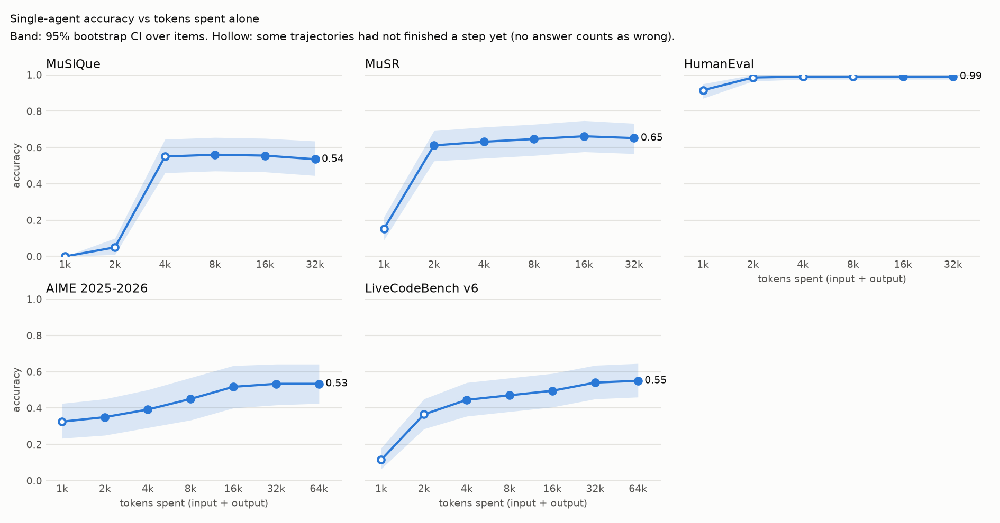

# Solo-scaling calibration: results

**Question.** If one agent keeps working on a problem alone, does spending more tokens make it
more accurate, and over what range? The follow-up study asks *after how many tokens of solo work
a team should start collaborating*. That question only makes sense on benchmarks where extra
solo tokens actually buy accuracy, so this calibration decides which benchmarks to keep.

**Short answer.** Keep **AIME** and **LiveCodeBench (hard problems)**: accuracy rises by about
+0.17 to +0.19 with more solo tokens and then levels off at a measurable point. Drop
**MuSiQue** (extra work makes the agent give up and answer "not stated"), **MuSR** (answers
churn without a reliable net gain) and **HumanEval** (already at the ceiling).

## How it was measured

- **Model.** `gpt-6-luna`, `reasoning_effort = "none"`, temperature 0.7, the same as the pilot.
  With effort "none" all reasoning is visible text, so every token is accounted for.
- **What the agent does.** It writes a first answer, then repeatedly checks and revises its own
  work. Each self-check uses one of three methods in rotation: solve again by a different route
  and compare, audit every step, or test the strongest alternative answer. It keeps its answer
  unless the check finds a concrete mistake, and every prompt tells it to always commit to an
  answer.
- **Token checkpoints.** The agent keeps going until it has spent 32,000 tokens. Its current
  answer is scored at 1k, 2k, 4k, 8k, 16k and 32k tokens, so one run per problem gives the whole
  curve. Tokens count input + output, the same way the team budget counts them. AIME and
  LiveCodeBench were still rising at 32k, so they were continued to 64k.
- **Sample.** 100 MuSiQue, 99 MuSR, 100 HumanEval, all 60 AIME 2025-2026 problems and 100
  LiveCodeBench medium/hard problems, each run twice: 918 runs and 8,064 model calls.
- **Cost.** $2.45 of the $10 cap.
- **Uncertainty.** Numbers in brackets are 95% confidence intervals. A gain whose interval does
  not include zero is a real effect, not noise.

## Accuracy at each token checkpoint

At an early checkpoint a run may not have finished its first answer yet, which counts as wrong.
MuSiQue's reading passages alone take about 2,700 tokens, so it cannot answer at all by 1k or 2k.

| Benchmark | 1k | 2k | 4k | 8k | 16k | 32k | 64k |
|---|---|---|---|---|---|---|---|
| **AIME** (math) | 0.33 | 0.35 | 0.39 | 0.45 | 0.52 | 0.53 | 0.53 |
| **LiveCodeBench** (coding) | 0.12 | 0.36 | 0.45 | 0.47 | 0.49 | 0.54 | 0.55 |
| - hard problems (67) | 0.01 | 0.24 | 0.27 | 0.30 | 0.34 | 0.40 | 0.42 |
| - medium problems (33) | 0.32 | 0.62 | 0.80 | 0.82 | 0.82 | 0.82 | 0.82 |
| MuSiQue (multi-hop QA) | 0.00 | 0.05 | 0.55 | 0.56 | 0.56 | 0.54 | - |
| MuSR (narrative reasoning) | 0.15 | 0.61 | 0.63 | 0.65 | 0.66 | 0.65 | - |
| HumanEval (easy coding) | 0.92 | 0.98 | 0.99 | 0.99 | 0.99 | 0.99 | - |

Confidence intervals per checkpoint are about +-0.09 to +-0.12 (widest for AIME, which has
the fewest problems). The full table with intervals is in the README's "Solo-scaling calibration"
section.

## Summary per benchmark

"First answer" is the agent's initial answer before any self-check. "Fixes / breaks" counts
revisions that turned a wrong answer right and a right answer wrong.

| Benchmark | First answer | At 32k | Change | Fixes / breaks | Levels off at | Verdict |
|---|---|---|---|---|---|---|
| AIME | 0.34 | 0.53 | **+0.19** [+0.12, +0.28] | 31 / 8 | 16k | **keep** |
| LiveCodeBench | 0.37 | 0.54 | **+0.17** [+0.11, +0.23] | 29 / 5 | 32k | **keep** (hard problems) |
| MuSiQue | 0.57 | 0.54 | **-0.04** [-0.06, -0.01] | 1 / 8 | at the first answer | **drop** |
| MuSR | 0.61 | 0.65 | +0.04 [-0.02, +0.10] | 37 / 29 | 8k | **drop** |
| HumanEval | 0.92 | 0.99 | +0.07 [+0.04, +0.12] | 10 / 2 | 2k | **drop** |

## Where the model improved

### AIME (competition math): keep

- Accuracy climbs steadily from 0.34 to 0.53 over several doublings: +0.06 from 4k to 8k and
  +0.07 from 8k to 16k, both significant.
- It **levels off at about 16k tokens**: from 16k to 64k it gains only +0.02 [-0.03, +0.06].
- Self-checks fix 31 wrong answers for every 8 they break, so the agent is genuinely correcting
  mistakes, not just changing its mind.
- This gives a clean range for the follow-up study: onset points between about 2k and 16k solo
  tokens per agent, with a plateau after.
- The 2025 and 2026 problem sets behave alike (0.55 vs 0.52 at 32k), so there is no sign the
  model has memorized the older set.
- The catch is size: 60 problems is small (about +-0.11 per checkpoint). Adding AIME 2024 would
  tighten it, at some contamination risk.

### LiveCodeBench (competitive programming): keep, hard problems

- Accuracy rises from 0.37 to 0.54, still improving between 16k and 32k (+0.04 [+0.01, +0.08]).
- It **levels off at about 32k tokens**: from 32k to 64k it gains only +0.01.
- Self-checks fix 29 wrong solutions for every 5 they break.
- **Hard problems carry the range**: 0.24 at 2k to 0.40 at 32k. LeetCode hard problems went
  from 0.33 at 2k to 0.73 at 32k.
- **Medium problems saturate early**: 0.80 by 4k, then flat. They add little to an onset study.
- Each solution is graded by running it against the benchmark's own hidden tests, so the
  checker is objective.

## The issue with MuSiQue

MuSiQue gets slightly **worse** with more solo work (-0.04), because the agent talks itself out
of correct answers into non-answers.

- Of the 7 runs that lost a correct first answer, **6 ended on a non-answer** such as "Not
  stated" or "Cannot be determined". Examples:
  - "1930" became "Not stated"
  - "1839" became "Not stated"
  - "Cabarrus County" became "Cannot be determined from the paragraphs"
  - "Green Bay" became "Cannot be determined"
- Non-answers grew from **5.5% of first answers to 14% at 32k**.
- This happened even though the prompt explicitly says every question is answerable and every
  self-check tells the agent to commit to an answer. Both were added specifically to stop it.
- Only one revision in the whole benchmark turned a wrong answer right.
- Looking at partial credit (word overlap with the gold answer) does not change the picture: it
  stays flat at 0.66-0.69.
- This is the same "abstention drift" the pilot found. Two rounds of self-revision dropped the
  pilot's single agent from 0.60 to 0.40. The new prompts make it milder, but it is still there.
- MuSiQue is also costly to start: the agent needs about 2,700 tokens just to read the
  passages, so the small checkpoints are empty.

**Takeaway:** on MuSiQue, extra solo tokens buy caution, not accuracy. It cannot show when
collaboration should start.

## What we found with MuSR

MuSR shows **no reliable gain** (+0.04, with an interval from -0.02 to +0.10) and a lot of churn:
self-checks fixed 37 answers but broke 29, so the agent mostly swaps one guess for another.

The three MuSR story types behave differently:

| Story type | First answer | At 32k | Pattern |
|---|---|---|---|
| Murder mysteries | 0.80 | 0.80 | flat |
| Object placements | 0.45 | 0.44 | flat |
| Team allocation | 0.58 | 0.71 | rises (+0.14 [+0.03, +0.24]) |

Team allocation on its own does improve, so it could be a secondary candidate later. But it has
only 33 problems, too few to rely on. MuSR as a whole is the one result where the interval is too
wide to rule out a small gain, but any such gain is too small and noisy to build a study on.

## What we found with HumanEval

HumanEval is **at the ceiling**. The first answer is already 0.92, and one self-check brings it
to 0.98, then 0.99 from 4k on. All of the improvement happens in the first check (10 fixes,
2 breaks). Nothing is left for the remaining tokens to buy, which matches the pilot, where
discussing teams scored 1.00.

## Tokens actually used

The "tokens used" value is what the agent had actually spent when it held its answer at each
checkpoint. "Steps" is how many answer-plus-self-check rounds fit in 32k.

| Benchmark | Steps by 32k | Tokens written by the agent by 32k | Share of tokens that are writing |
|---|---|---|---|
| MuSiQue | 7.4 | 980 | 3% |
| MuSR | 10.2 | 1,572 | 5% |
| HumanEval | 10.4 | 2,707 | 9% |
| AIME | 9.0 | 3,546 | 12% |
| LiveCodeBench | 7.0 | 4,669 | 17% |

Most of the 32k is the agent re-reading its growing conversation before each step: only 3-17%
is new writing. That is how the team budget counts tokens too, so the follow-up should count
them the same way.

## Caveats

- **Short steps.** With reasoning effort "none", each step writes only 100-700 tokens. A model
  with hidden reasoning would spend the same budget very differently.
- **Some first answers had no answer.** 10% of AIME and 9.5% of LiveCodeBench first responses
  ended with reasoning but no final answer or code; the first self-check fixed nearly all of
  them. Leaving those runs out, the gains are still +0.17 (AIME) and +0.11 (LiveCodeBench), both
  significant, so the gains are real revision, not just recovering a missing answer.
- **Contamination.** All five benchmarks predate the model's training cutoff (May 2026). No
  newer set with an objective checker exists for these task types.
- **Grading stability.** LiveCodeBench tests have a 6-second limit, so a borderline-slow program
  could pass or fail depending on machine load. When the 64k run rescored all 2,462 answers
  independently, every pass/fail result matched.

## What this means for the follow-up study

- Use **AIME** and **LiveCodeBench hard problems**.
- Put collaboration-onset points where the solo curve is still rising: roughly **2k-16k tokens**
  for AIME and **2k-32k** for LiveCodeBench, plus onset at 0 (discussion right after the first
  answer).
- Compare onset points on the **same problems** (paired), because per-checkpoint uncertainty is
  still about +-0.10.
- Start every team from the same solo runs and branch at each onset point. The 64k extension
  showed this works: all 2,500 earlier calls were reused from the log at no cost.

## Where things are

- Plot: [`solo-calibration.png`](solo-calibration.png)
- Full tables and method: the README's "Solo-scaling calibration" section
- Configs: `configs/solo-calibration.toml` (1k-32k) and `configs/solo-calibration-64k.toml`
  (64k extension)
- Run logs: `runs/calibration/` in the main checkout (not in git)
