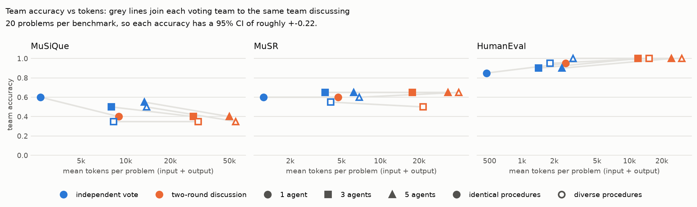

# Team study: results

**Question.** Do teams of LLM agents beat a single agent when the whole team shares a fixed
token budget per problem? And if they do, is it the number of agents, giving them different
problem-solving procedures, or letting them discuss that helps?

**Short answer.** At this scale, no team setup reliably beat a single agent.

- **Discussion never improved accuracy**, and it cost 3-10x the tokens of a simple vote.
- **On MuSiQue, discussion made things worse**: agents talked each other into answering
  "not stated".
- **Teams often had the right answer and failed to pick it**: at least one agent was right much
  more often than the team's final answer was.
- **Different procedures made agents think differently** (less similar solutions, less
  correlated mistakes), but that did not turn into accuracy.

With 20 problems per benchmark, each accuracy number is uncertain by about +-0.2, so this study
can detect large effects only. The [last section](#what-is-statistically-solid) separates what
is solid from what is not.

*How to read the figure: blue points are teams that vote on their independent answers; orange
points are the same teams after two rounds of discussion. Each grey line joins a team's vote to
its discussion. Lines that run right and down mean discussion cost more tokens and lost
accuracy.*

## How the study worked

- **Model.** `gpt-6-luna`, `reasoning_effort = "none"`, temperature 0.7. It is the cheapest
  current OpenAI model, and with effort "none" all of its reasoning is visible text.
- **Benchmarks** (20 problems each):
  - **MuSiQue**: questions that need facts combined from several of 20 paragraphs.
  - **MuSR**: long stories with a multiple-choice question: murder mysteries, object
    placements and team allocation.
  - **HumanEval**: write a Python function, graded by hidden tests.
- **Ten team setups**:
  - **Team size**: 1, 3 or 5 agents.
  - **Procedures**: *identical* (every agent gets the same generic instructions) or *diverse*
    (agents get different methods: break the problem down, list the evidence first, or try to
    falsify candidate answers). A single agent can only be identical.
  - **Communication**: an *independent vote* (agents answer separately, majority wins) or
    *two-round discussion* (agents see each other's anonymized answers, critique and revise
    twice, then vote).
- **Fixed budget.** Each problem had a token budget shared by the whole team (100k MuSiQue, 80k
  MuSR, 65k HumanEval, counting input and output). Agents were told their allowance. The budget
  was never exceeded, and it was tight in only one trial.
- **Size and cost.** 600 trials and 4,080 model calls, costing **$0.79**.

## Team accuracy by setup

Accuracy is the share of problems the team's final answer got right, with its 95% confidence
interval. "Vote" is the independent vote; "Discuss" is two-round discussion.

| Setup | MuSiQue | MuSR | HumanEval |
|---|---|---|---|
| 1 agent, alone | 0.60 [0.40, 0.80] | 0.60 [0.40, 0.80] | 0.85 [0.70, 1.00] |
| 1 agent, self-revision x2 | 0.40 [0.20, 0.60] | 0.60 [0.40, 0.80] | 0.95 [0.85, 1.00] |
| 3 identical, vote | 0.50 [0.30, 0.70] | 0.65 [0.45, 0.85] | 0.90 [0.75, 1.00] |
| 3 identical, discuss | 0.40 [0.20, 0.60] | 0.65 [0.45, 0.85] | 1.00 |
| 3 diverse, vote | 0.35 [0.15, 0.55] | 0.55 [0.35, 0.75] | 0.95 [0.85, 1.00] |
| 3 diverse, discuss | 0.35 [0.15, 0.55] | 0.50 [0.30, 0.70] | 1.00 |
| 5 identical, vote | 0.55 [0.35, 0.75] | 0.65 [0.45, 0.85] | 0.90 [0.75, 1.00] |
| 5 identical, discuss | 0.40 [0.20, 0.60] | 0.65 [0.45, 0.85] | 1.00 |
| 5 diverse, vote | 0.50 [0.30, 0.70] | 0.60 [0.40, 0.80] | 1.00 |
| 5 diverse, discuss | 0.35 [0.15, 0.55] | 0.65 [0.45, 0.85] | 1.00 |

## Findings

### 1. Discussion did not help, and on MuSiQue it hurt

Compared with the same team voting on its independent answers:

- **MuSiQue: worse.** Every discussing team scored at or below its voting counterpart (0.35-0.40
  against 0.35-0.55). A single agent revising its own answer twice fell from 0.60 to 0.40, a
  drop of -0.20 [-0.40, -0.05], which is statistically significant.
- **MuSR: no change.** Discussion moved accuracy by -0.05 to +0.05.
- **HumanEval: a hint of help, at the ceiling.** Discussing teams of 3 or 5 all scored 1.00
  against 0.90-1.00 for voting teams. The gain (+0.10 at most) is not distinguishable from
  zero, but discussion did make teams better than their average member (+0.05 to +0.12,
  significant in three of the four team setups).

### 2. The MuSiQue issue: discussion talks agents into "not stated"

Every MuSiQue question has an answer in the paragraphs. During discussion, agents increasingly
decided it did not:

- Among agents in discussing teams, non-answers such as "not stated in the paragraphs" or
  "cannot be determined" rose from **23% of first answers to 49% after two rounds**.
- Discussion **overturned a correct majority** in 12-30% of the problems where most agents had
  started out right. Voting never does that.
- Across all MuSiQue setups, **70 of the 112 wrong team answers were non-answers**.

The agents' doubts spread: once one agent questions whether the paragraphs support an answer,
the others tend to agree. The [solo-scaling calibration](solo-calibration-results.md) later
showed the same drift in a single agent checking its own work, even when told explicitly that
every question is answerable.

### 3. Teams had the right answer but did not pick it

The "oracle" is the share of problems where at least one agent's first answer was right:
roughly the best a perfect selection could do.

| Benchmark | Oracle (teams of 3-5) | Team's final answer | Lost in selection |
|---|---|---|---|
| MuSiQue | 0.55-0.70 | 0.35-0.55 | 0.10-0.30 |
| MuSR | 0.70-0.85 | 0.50-0.65 | 0.05-0.25 |
| HumanEval | 0.95-1.00 | 0.90-1.00 | at most 0.10 |

On MuSiQue and MuSR, adding agents raised the chance that *someone* was right, but neither
voting nor discussion reliably found that agent. Selection, not generation, is the bottleneck.

### 4. More voters did not reliably help either

Independent voting teams of 3 or 5 did not reliably beat a single agent:

- **MuSiQue**: 0.35-0.55 against 0.60.
- **MuSR**: 0.55-0.65 against 0.60.
- **HumanEval**: 0.90-1.00 against 0.85, within the uncertainty of 20 problems.

### 5. Diverse procedures changed how agents worked, not how often they were right

Teams whose agents had different procedures, compared with identical teams:

- **Less similar first solutions**: text similarity 0.65-0.70 against 0.73-0.80 on MuSiQue and
  HumanEval.
- **Less correlated mistakes**: error correlation 0.09-0.30 against 0.39-0.52 on HumanEval, and
  0.53-0.72 against 0.67-0.84 on MuSiQue.
- **More disagreement before discussion** on MuSiQue: 0.36-0.45 against 0.24-0.33.

So the manipulation works, but it did not translate into team accuracy (diverse teams were
never reliably better). On MuSR the procedures barely changed behaviour at all. Among the
procedures, *falsification* (try to rule out candidate answers) was strongest on MuSiQue:
0.56 individual accuracy, against 0.40 for *evidence first*.

### 6. Talking is expensive

At equal team size, two rounds of discussion used **3-10x the tokens** of a vote, because
every agent re-reads every teammate's answer each round. For the largest teams that is about
50,000 tokens per MuSiQue problem against 13,000. Per 10,000 tokens spent, a single agent was
the most accurate setup on every benchmark:

| Benchmark | Single agent | Best team |
|---|---|---|
| MuSiQue | 2.25 correct per 10k tokens | 0.63 |
| MuSR | 4.83 | 1.74 |
| HumanEval | 18.1 | 6.31 |

### 7. HumanEval is too easy for this question

A single agent already passes 85% of problems, and every discussing team of 3 or 5 passes all
20. That leaves no room to tell setups apart.

## What is statistically solid

**Solid** (the confidence interval excludes zero, or the quantity is measured precisely):

- A single agent revising its own MuSiQue answer loses accuracy (-0.20 [-0.40, -0.05]).
- Discussion pushes MuSiQue agents toward non-answers (23% to 49%).
- On HumanEval, discussion makes teams better than their average member.
- Discussion costs 3-10x the tokens of voting.
- Diverse procedures make agents' solutions and mistakes less alike.

**Not solid** (consistent direction, but the intervals of about +-0.2 overlap):

- Any ranking of team setups by accuracy: for example, "voting teams of 5 are better than
  discussing teams of 5 on MuSiQue".
- Whether diversity or team size helps or hurts accuracy.

## What came next

- **The full first experiment** uses the same design at full scale: 600 MuSiQue, all 756 MuSR
  and all 164 HumanEval problems, 3 replications each, projected at about $56 from this study's
  measured costs. At that size the intervals shrink to about +-0.04 on MuSiQue and MuSR and
  +-0.05 to +-0.08 on HumanEval.
- **Benchmark choice.** HumanEval's ceiling and MuSiQue's abstention problem led to the
  [solo-scaling calibration](solo-calibration-results.md). It recommends AIME and LiveCodeBench
  (hard problems) for the next study, on when a team should start collaborating.

## Glossary

- **Oracle**: at least one agent's first answer was correct.
- **Selection gain**: team accuracy minus the average accuracy of its members' first answers.
- **Coordination gain**: a discussing team's accuracy minus the same team's independent vote.
- **Confidence interval [a, b]**: the range the true value plausibly lies in, given only 20
  problems. A difference whose interval includes zero could be noise.

## Where things are

- Figure: [`team-study.png`](team-study.png), redrawn with `uv run workforce plot-teams <run>
  --out team-study.png`
- Full tables (gains, team process, procedures, budget calibration): the README's
  "Team study" section
- Config: `configs/team-study.toml`
- Run logs: not in the repository. To reproduce:
  `uv run workforce run configs/team-study.toml --env-file .env` (about $0.80).
